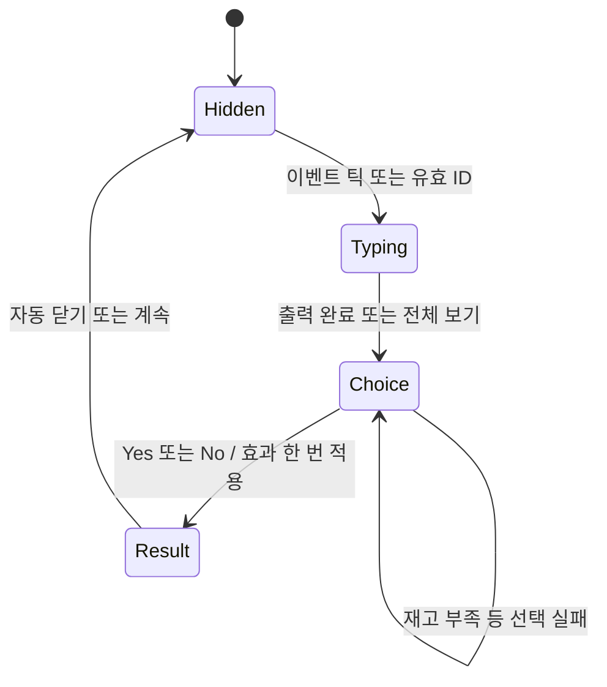

# 선택형 노트북 이벤트 팝업

2026-11-18 · 사용자 예시 12개 사건의 Yes/No 효과 구현·Play 검증 완료. 《60 Seconds!》 같은 사건 알림을 참고한 기존 노트북 프레임/타이핑 유지.

## 발생과 상태

- 시간은 모두 틱. 기존 `BunkerRules.randomEventEveryTicks`가 발생 간격 정본이며 현재 10틱이다. 별도 시계/시간 환산 없음. 마지막 틱은 개발 종료 우선.
- 직전 사건과 조건 불충족 사건을 제외한 뒤 균등 추첨. 후보가 없으면 건너뛰며 한 건뿐이어도 직전 사건을 반복하지 않는다.
- ev_party는 choco>=1일 때만 발생. 선택 직전에도 조건을 다시 확인한다.
- 표시 중 벙커 틱·캐릭터 이동·신규 월드 클릭 정지. 외부 수동 Paused는 창을 닫아도 보존.

번호 영역에는 `EVENT / ev_door`처럼 사용자 사건 ID를 표시한다. 제목은 즉시, 본문은 초당 30개 텍스트 요소 기준 타이핑. Enter/Space 또는 전체 보기 버튼은 타이핑을 끝낸다. Choice 상태에서는 Yes/No 버튼 또는 Y/N 키로 선택하며 Enter로 임의 Yes를 선택하지 않는다. 선택 버튼은 타이핑이 끝나면 표시한다.

선택 후 실제 변화량을 한 줄로 보여 준다. 예: `초콜렛 +1 · 다음 적 HP +4`, `멘탈 3명 -5`, `변화 없음`. 기본 3초의 UI 연출 뒤 자동 닫히며 계속/Enter/Space로 빨리 닫을 수도 있다. UI 연출은 unscaled time이며 게임 틱을 진행시키지 않는다. 선택 버튼은 즉시 숨기고 중복 호출을 거부한다. 결과창이 닫힌 뒤 시간이 다시 흐른다.

같은 틱에 사건과 습격이 겹치면 작업 → 사건 선택/결과 → 습격 순서다. 틱 후반부를 한 번만 처리하여 방금 선택한 다음 습격 HP 보정이 소비되게 한다.

## 효과·실패·수명

[Events 명세](../DataSpecs/Events.md)에 문법/단위/제약과 필드별 계약이 있다. MENTAL은 기존 CurrentMental, PROGRESS는 기존 GameDevManager, ITEM은 ShelterSupplies, NEXT_WAVE_HP는 BunkerSimulation을 사용한다. 기본 적 HP와 실제 적 전투는 아직 없으며 외부 적 생성기는 GetCurrentWaveEnemyHp(baseHp)를 소비해야 한다.

전체 효과를 먼저 계산/검증하고 반영한다. 재고 부족/수치 범위 초과면 다른 효과도 적용하지 않고 오류 한 줄을 보여 주며 다른 선택을 할 수 있다. 발생 조건 자체가 바뀌었으면 효과 없이 안내 결과를 보여 주고 닫는다. 빈 방 멘탈 효과는 건너뛴다. open은 선택 시작 시 100% 미만 개발 축.

EventPopupController.ShowEvent(string id)는 Shown/Busy/NotReady/NotFound/Ineligible 반환. 팝업 덮어쓰기/대기열 없음. 재시작 시 이전 사건·재고·멘탈·다음 습격 보정 초기화. 씬 종료/비활성 시 구독과 잠금 해제. 공용 GameData.Release를 창 닫기에서 호출하지 않는다. 잘못된 데이터는 로드 오류로 기록하며 임의 사건으로 대체하지 않는다.

## 편집 위치

| 역할 | 위치 |
|---|---|
| 사건 12개·Yes/No 효과·조건 | Assets/Settings/Data/Csv/Events.csv (`data.events`) |
| 물자 ID·표시명 | Assets/Settings/Data/Csv/ShelterItems.csv (`data.shelter.items`) |
| 발생 틱 간격 | Assets/Settings/Shelter/BunkerRules.asset (`data.bunker.rules`) |
| UI 프리팹 | Assets/Prefabs/UI/EventLaptopPopup.prefab |
| 배치 씬 | Assets/Scenes/ShelterPrototype.unity |
| 구현 | Assets/Scripts/Events, Assets/Scripts/Shelter/ShelterSupplies.cs |
| 제작/검사 | Assets/Editor/Events/EventPopupSetup.cs, EventPopupChecks.cs |

CSV는 UTF-8 BOM 포함. `Tools > Events > Import Event CSV`로 효과·참조 검증 및 공용 DB 갱신, 이후 Data Manager의 Addressables 콘텐츠 빌드. 런타임에서 CSV를 직접 다시 파싱하지 않는다. 임시 ID 1~3은 제거했고 제공된 ev_* ID를 사용한다. 이벤트별 능력/멘탈 기본값·발생 주기를 복제하지 않는다.

## 레이아웃과 아트

1920×1080 논리 영역/16:9 letterbox, 정렬 순서 100, 중앙 1120×760 노트북. 기존 Korean TMP 폰트 재사용. Laptop 아래 Number/Title/BodyScroll/Result/Yes/No/Confirm/Hint. 본문 860×165 마스크와 세로 스크롤, 결과 860×42 한 줄 자동 크기, Yes/No 각 180×56. 매우 긴 제목은 편집 검수 필요.

직렬화된 TMP·Button·Sprite 참조를 Editor에서 저장한다. 런타임 UI 조립 없음. `Install Laptop Popup`은 기존 프리팹 GUID와 외형을 유지하며 선택 요소/참조만 추가한다. Play 밖에서도 계층·이미지 편집 가능.

`Assets/Art/UI/Events/`의 laptop_frame.png(1120×760), button_normal/hover/pressed.png(180×56)를 사용한다. 아트 파일 변경 없음. PNG 교체 시 같은 경로·크기와 .meta를 보존한다. Sprite Single, 중앙 pivot, PPU100, Bilinear, mipmap 없음, 비슬라이스. 프리팹 GUID 27ae7b09da16b094c9378f228832e349. 실제 문구를 이미지에 굽지 않는다.

## 검증

[구현·검증 이력](../DataHistory/20261118-event-effects-02-verified.md), [Play 검사](../Events/Verification-effects-play.txt), [경계 검사](../Events/Verification-effects-edge.txt), [Edit 검사](../Events/Verification-effects-edit.txt).

24개 선택의 예상 수치, 선택 버튼 onClick, 연속 금지, 초콜렛 조건/소비, 빈 방, 선택 재검사, 원자적 거부, 결과 자동 닫기, 같은 틱 습격 지연·HP 1회 소비, 외부 정지·마지막 틱·재시작을 확인했다. [선택 화면](../Events/Preview-choices.png), [결과 화면](../Events/Preview-result.png), [실제 4:3 화면](../Events/Preview-choices-4x3.png) 시각 검수 완료.

Player 실행 파일, 실제 적 생성·전투, 파밍 물자 자동 매핑, 영구 저장, 의도적인 Addressables 장애 복구, 실제 하드웨어 Y/N 키 입력은 미검증 또는 범위 밖. 직접 벙커 실행은 기존 규칙상 사람이 없으며, 검사는 파밍 전달을 통해 생성한 실제 캐릭터 3명으로 수행했다.